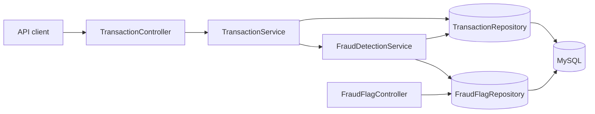

# FinTech Backend Service

A **Java 17 / Spring Boot 3** learning project for transaction processing and rule-based fraud screening. This is a portfolio demonstration, **not a production payment processor**.

## Implemented features

- `POST /api/transactions` creates a transaction and evaluates fraud rules.
- Transactions over **1,000** in amount generate a fraud flag.
- More than **3 transactions from the same sender in the last minute** generates a fraud flag.
- Transactions with flags receive `REVIEW_REQUIRED`; others receive `COMPLETED`.
- `GET /api/fraud-flags/{status}` retrieves flags by status (for example `NEW`).
- Unit tests cover the rule thresholds, combined flags, and transaction status decisions.

**Current limitations:** This demo does not implement actual bank settlement, JWT authentication, webhooks, reconciliation jobs, or a deployed dashboard. Spring Security is included, but currently uses its default configuration. Do not use real account numbers or payment data.

## Tech stack

Java 17, Spring Boot 3.5, Spring Data JPA / Hibernate, MySQL, Maven, JUnit 5, Mockito, Spring Security.

## Architecture



## Run locally

1. Install **JDK 17**, **MySQL**, and Maven (or use the included Maven wrapper).
2. Create an empty MySQL database named `fintech_db`.
3. Configure a local `src/main/resources/application.properties` (do not commit credentials):

   ```properties
   spring.application.name=fintech-backend
   spring.datasource.url=jdbc:mysql://localhost:3306/fintech_db
   spring.datasource.username=${DB_USERNAME}
   spring.datasource.password=${DB_PASSWORD}
   spring.jpa.hibernate.ddl-auto=update
   ```

   Set `DB_USERNAME` and `DB_PASSWORD` in your environment before running. The committed application properties do **not** yet configure a datasource.

4. Run `./mvnw spring-boot:run` (Windows: `mvnw.cmd spring-boot:run`).
5. Because the project includes Spring Security without a custom security configuration, Spring Boot's default login applies. Check the startup console for the generated development password; the default username is `user`.

## API examples

With the application running locally, substitute the generated development password for `YOUR_PASSWORD`:

```bash
curl -u user:YOUR_PASSWORD -X POST http://localhost:8080/api/transactions \
  -H "Content-Type: application/json" \
  -d '{"senderAccount":"demo-sender","receiverAccount":"demo-recipient","amount":1250.00}'
```

A flagged transaction should return a transaction object with `status: "REVIEW_REQUIRED"`. To inspect new flags:

```bash
curl -u user:YOUR_PASSWORD http://localhost:8080/api/fraud-flags/NEW
```

**Note:** Default Spring Security also enables CSRF protection. For POST requests from non-browser API clients, a CSRF token or an explicitly configured API security policy is needed; the POST example above illustrates the payload but may return HTTP 403 with the current default configuration.

## Tests

```bash
./mvnw test
```

The new unit tests mock repository dependencies, so they do not require a live MySQL database. The existing `@SpringBootTest` context-load test may require additional test database configuration.

## Next improvements

- Add request DTOs and Bean Validation (positive amount, required accounts).
- Implement explicit API security (authentication, authorization, and CSRF strategy).
- Add integration tests using an isolated test database.
- Use database migrations and transaction boundaries.
- Add CI, OpenAPI documentation, and deployment instructions.
